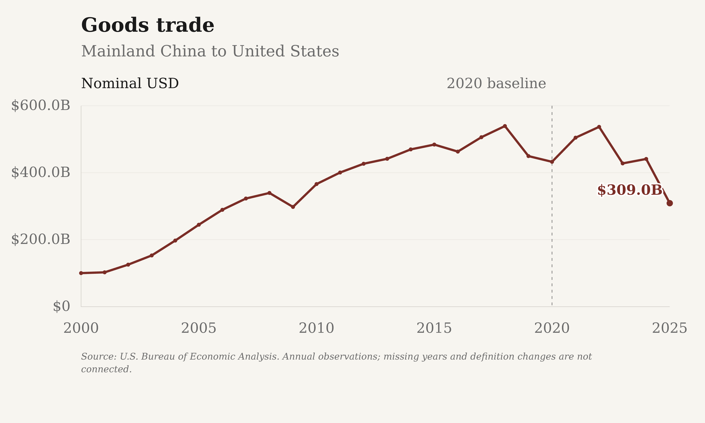

<div align="center">
  <h1>People, Trade, and Connections Between the United States and China</h1>
  <p>
    <a href="#us-china-connections-since-2000">Overview</a> ·
    <a href="#explore-the-evidence">Analyses</a> ·
    <a href="#setup">Setup</a> ·
    <a href="https://www.themarginoferror.com/china-us-relations/">Live site</a>
  </p>
</div>

---

## U.S.-China connections since 2000

Source-backed charts following student exchanges, travel, trade, immigration
and public opinion between the United States and China. Related analyses examine
language learning, businesses, Confucius programs and U.S. media on Weibo.
Histories begin in 2000 where verified; each measure retains its own available
years, population and definition. These are separate indicators, not a composite
index of the bilateral relationship.

Mainland China, Hong Kong and Macau remain distinct in the public comparisons.
Taiwan observations are retained separately in the complete research data.
Academic years use their **ending year**; calendar years, fiscal years, survey
rounds and matched year-to-date periods are labelled rather than treated as
interchangeable annual observations.

<p align="center">
  <a href="https://www.themarginoferror.com/china-us-relations/trade.html">
    
  </a>
</p>

## Explore the evidence

**Movement and exchange:** [student enrollment and study abroad](https://www.themarginoferror.com/china-us-relations/),
[travel and tourism](https://www.themarginoferror.com/china-us-relations/travel.html),
and [goods and services trade](https://www.themarginoferror.com/china-us-relations/trade.html).
Both directions are available where verified. Enrollment excludes OPT when
labelled enrolled-only; visitor trips are not unique people or necessarily
leisure travel; goods and services remain separate.

**Migration and attitudes:** [immigration](https://www.themarginoferror.com/china-us-relations/immigration.html)
distinguishes annual permanent-resident admissions from resident stocks and
includes a 50-state/DC China-born resident map.
[Public opinion](https://www.themarginoferror.com/china-us-relations/opinions.html)
covers both directions and age comparisons, keeping favorable percentages
separate from warmth scores and preserving each survey's population.

**Language and institutions:** [Chinese, Japanese and Korean](https://www.themarginoferror.com/china-us-relations/language-learning.html)
are compared separately through available course, degree and school indicators.
[Confucius Institutes and Classrooms](https://www.themarginoferror.com/china-us-relations/confucius.html)
distinguishes dated counts, directory listings and documented successors.
[Business presence](https://www.themarginoferror.com/china-us-relations/business-presence.html)
keeps source populations and enterprise definitions separate, without combining
different European countries into an invented total.

**Media connections:** [U.S. media on Weibo](https://www.themarginoferror.com/china-us-relations/weibo.html)
is an evidence-backed directory of accounts and Chinese-language editions,
not an exhaustive census or a measure of popularity. See the
[research inventory](reports/weibo_media_inventory.md) and
[collector guide](docs/WEIBO.md) for identity evidence and recovery limits.

## Working with the charts

Charts provide source notes, exact values through hover, touch or keyboard,
and complete CSV/JSON downloads. The research figure collection is in
[`outputs/figures/`](outputs/figures), organized by topic. Editable SVG and
high-resolution PNG versions use the same house style as `uk_decline`, with
**The Margin of Error** (`#F7F5F0`) and **Substack** (`#F5F5F5`) backgrounds.

The public edition shows histories reaching at least **2023** and standalone
snapshots from **2024-2026**, using measurement dates rather than upload dates.
Complete downloads and the offline research edition retain older observations;
the archive is not the current public chart selection.
Single-series annual levels use bars, with missing years left blank. Shading
marks the principal **2020-2022 COVID travel-restriction years**, not a universal
ban or an explanation of every change.

## Automatic updates

The [exchange refresh workflow](.github/workflows/update-exchange.yml) is scheduled
daily at **11:23 UTC**. It checks supported sources, preserves last-known-good
data on retrieval failures, and validates candidate data and charts before
committing meaningful updates. Some reviewed sources require manual checks or
permission and are not automatically downloaded.

The separate host, [`hanshanley/margin_of_error`](https://github.com/hanshanley/margin_of_error),
builds the public edition from this repository's `main` branch and is scheduled
to republish at **09:20 and 21:20 UTC**. Scheduled times are not guarantees of
new data or immediate publication.

Private Weibo collection is a separate process. Its unattended operation remains
blocked by local file-access authorization; scheduled chart builds do not prove
that new posts were collected. See [collection operation](docs/EXCHANGE.md#automatic-private-weibo-refresh).

## Setup

Python 3.9+:

```bash
python3 -m venv .venv
./.venv/bin/python -m pip install -r requirements-exchange-dev.txt
```

Build from the committed data without fetching sources:

```bash
./.venv/bin/python scripts/build_site.py
./.venv/bin/python scripts/build_exchange_publication.py --output data/local/publication
```

Open `site/index.html` for the complete offline research edition, or
`data/local/publication/index.html` for the filtered public edition.
The builders also generate downloads and chart exports.

```bash
./.venv/bin/python scripts/update.py                         # check supported sources
PYTHONPATH=src ./.venv/bin/python -m pytest tests/test_exchange_*.py -q
```

See [methods and operation](docs/EXCHANGE.md), [source contracts](docs/SOURCES.md),
and the [Weibo CLI guide](docs/WEIBO.md) for source-specific commands and checks.

## Data integrity

Reviewed inputs are tracked in [`data/site/`](data/site); raw responses, private
databases and post corpora stay under ignored `data/local/`. Observations retain
definitions, reference periods, source links and provenance. Missing or suppressed
values are not zero, incompatible definitions are not spliced, and resident
stocks are not converted into annual flows.

Some bilateral measures remain unverified, including comparable annual
U.S.-to-mainland-China permanent immigration. Older national language-course
counts are not made current by newer degree or program figures. The
[project checklist](TASKS.md) records verified work and remaining gaps.
Public exports contain complete selected datasets, not metadata-only substitutes;
they do not redistribute source reports or the private Weibo text corpus.
